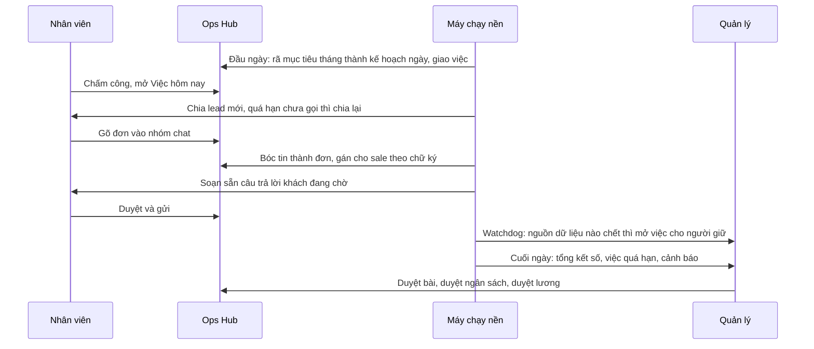
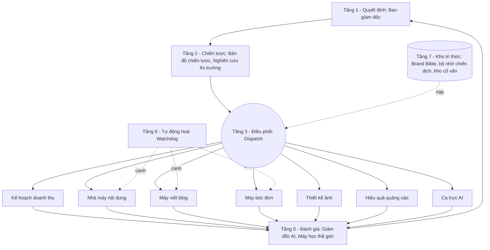

# Sơ đồ vận hành Ops Hub

Tài liệu này mô tả hệ thống chạy thế nào: dữ liệu đi đâu, ai làm gì, máy được tự làm tới đâu, và những nguyên tắc rút ra khi vận hành thật.

## 1. Dữ liệu chảy qua hệ thống

Mọi thứ đi một chiều: nguồn bên ngoài đổ vào, máy chuẩn hoá về một kho, trợ lý AI đọc kho để soạn việc, và chỉ những thứ qua cổng mới ra tới khách hoặc tới tiền.

```mermaid
flowchart LR
  subgraph NGUON[Nguồn]
    A1[Nhóm chat ghi đơn]
    A2[Hãng vận chuyển]
    A3[Sao kê ngân hàng]
    A4[Inbox Zalo, Facebook]
    A5[Quảng cáo, form, quiz]
  end
  subgraph NAP[Ống nạp]
    B1[Webhook ghi tin thô]
    B2[LLM bóc tin thành đơn]
    B3[Nhập Excel, CSV]
    B4[Máy cào dùng phiên đăng nhập]
  end
  subgraph KHO[Kho chung - Supabase]
    C1[(Postgres + phân quyền theo dòng)]
    C2[(Bảng cấu hình key-value)]
    C3[(Kho tri thức vector)]
  end
  subgraph MAY[Máy và trợ lý AI]
    D1[Tính số, chia lead, nhắc việc]
    D2[Soạn bài, soạn tin trả lời]
    D3[Bản tin sáng, chiều, tuần]
  end
  subgraph CONG[Cổng ra]
    E1{Lọc từ cấm}
    E2{Người bấm duyệt}
    E3{Trần tiền khoá cứng}
  end
  NGUON --> NAP --> KHO --> MAY --> CONG --> F[Khách, kênh, tiền]
```

## 2. Một ngày vận hành

## 3. Chức năng theo khối

| Khối | Câu hỏi nó trả lời | Màn hình tiêu biểu |
|---|---|---|
| Việc hằng ngày | Hôm nay tôi làm gì | Việc hôm nay, bảng công việc, kế hoạch ngày, chấm công, xin nghỉ |
| Bán hàng và khách | Bán gì, cho ai, tiền về tới đâu | Kết cấu bán hàng, chia lead, khách 360, tệp khách, gán đơn, hộp thư Zalo |
| Marketing và nội dung | Đăng gì, quảng cáo chạy ra sao | Dispatch, lịch chiến dịch, tuyến bài theo phễu, kho app AI, quảng cáo |
| Điều hành và tài chính | Đang thắng hay thua | Trung tâm chỉ huy, vòng lặp doanh thu, bản đồ chiến lược, tài chính, tài sản |
| Nhân sự và thu nhập | Người, lương, thi đua | Lương của tôi, bảng lương, KPI, thi đua, tuyển dụng |
| Kiến thức và quy trình | Không nhớ thì tra ở đâu | SOP, kho kiến thức, tuân thủ |
| Đối tác | Mở rộng ngoài bán lẻ | Đại lý, hợp đồng, sổ pháp chế |
| Quản trị hệ thống | Máy nào đang sống | Máy chạy ngầm, nhật ký AI, két khoá API, chi phí công cụ |

## 4. Đội trợ lý AI theo tầng và mức tự chủ

Mỗi trợ lý được khai rõ **mức tự chủ** và **cái chốt** đang chặn mức đó. Không khai được chốt thì không được khai mức.

| Mức | Ý nghĩa |
|---|---|
| Người quyết | Tầng con người, máy không thay |
| Chỉ đọc | Tính và trình số, không hành động ra ngoài |
| Đề xuất | Máy soạn, người bấm mới đi |
| Chờ duyệt | Máy làm ra sản phẩm, chủ duyệt mới phát hành |
| Tự làm trong hạn | Tự chạy, nhưng trong trần đã khoá cứng |

| Trợ lý | Mức | Chốt chặn |
|---|---|---|
| Nghiên cứu | Tự làm trong hạn | Chỉ ghi kho nội bộ, không ra khách |
| Dispatch | Đề xuất | Người chốt kế hoạch thì máy mới chạy |
| Nhà máy nội dung | Chờ duyệt | Bài đẩy vào chat chờ bấm Đăng hoặc Bỏ, qua cổng từ cấm |
| Máy viết blog | Tự làm trong hạn | Cổng từ cấm, bài không qua thì không đăng |
| Máy bóc đơn | Tự làm trong hạn | Chỉ ghi đơn, không đụng tiền, không gửi ai |
| Thiết kế ảnh | Tự làm trong hạn | Cấm cận mặt người, cấm chữ, cấm bao bì giả |
| Hiệu quả quảng cáo | Đề xuất | Tự lái mặc định tắt, trần ngân sách/ngày kẹp ở một hàm, nút tiền chỉ ở chat riêng chủ |
| Ca trực AI | Đề xuất | Người bấm gửi |
| Giám đốc AI | Tự làm trong hạn | Chỉ gửi bản tin cho chủ |
| Watchdog | Tự làm trong hạn | Mỗi nguồn chết mở đúng một việc, sống lại tự đóng |

Sổ đăng ký trợ lý nằm ở `lib/ai-map.ts`. Thêm trợ lý mới là thêm một dòng ở đó.

## 5. Lịch máy chạy nền

Khoảng 70 tác vụ trong `vercel.json`. Việc lặp mỗi ngày đặt vào giờ làm buổi sáng (máy văn phòng tắt ban đêm thì việc không chạy); nhiều việc cùng khung thì rải lệch phút.

| Nhịp | Ví dụ |
|---|---|
| Vài phút | Chia lại lead quá hạn, báo đơn mới, đọc bình luận Facebook, trả lời nhóm Zalo |
| Mỗi giờ | Bóc đơn từ nhóm chat, nhắc sale trong giờ làm |
| Hằng ngày | Bản tin sáng, chiều; kế hoạch ngày; chi tiêu quảng cáo; đối soát; viết blog; chuỗi chăm sóc khách |
| Hằng tuần, tháng | Báo cáo phễu, SEO, rà thương hiệu, bản tin chiến lược, tính lương đầu tháng, báo cáo tháng |

## 6. Mô hình dữ liệu

| Miền | Thực thể chính |
|---|---|
| Con người | Người dùng, phòng ban, hợp đồng, lịch sử lương |
| Chấm công, nghỉ | Chấm công, yêu cầu sửa công, đơn nghỉ, quỹ phép |
| Hiệu suất | Chu kỳ KPI, KPI, check-in tuần, 1-1, luật thưởng |
| Khách, lead | Lead, khách, nhật ký chăm sóc, lịch tư vấn, đồng ý dữ liệu |
| Đơn, doanh thu | Tin chat thô, đơn bóc từ chat, đơn và dòng hàng, vận đơn |
| Tài chính | Sao kê, giao dịch ngân hàng, chi phí, khoản vay, công nợ đại lý |
| Nội dung | Bài nội dung, bài đã đăng, sổ việc của máy |
| Đào tạo, tuyển dụng | Bài kiến thức, bài kiểm tra, khoá học, tin tuyển, ứng viên |
| Hệ thống | Cấu hình key-value, thông báo, nhật ký kiểm toán, két bí mật, kho vector |

## 7. Mười nguyên tắc rút ra khi vận hành

1. **Cào ra rỗng thì dừng, không ghi.** Phiên đăng nhập hết hạn làm máy cào ra số 0 rồi ghi đè lên số thật. Kết quả rỗng phải thoát lỗi, giữ số cũ và báo đỏ.
2. **Một cửa cho doanh thu.** Mọi nơi cần doanh thu đi qua một module (`lib/doanh-thu.ts`), để đổi nguồn chỉ phải sửa một chỗ.
3. **Nguồn chính phải được phép kêu.** Nguồn đánh dấu "chỉ tham khảo" thì chết mà không ai biết. Nguồn chính phải nằm trong danh sách báo động.
4. **Đo sản lượng, không chỉ đo nhịp tim.** Một máy có thể chạy đều suốt tuần mà không đẻ ra sản phẩm nào.
5. **Máy soạn, người bấm.** Mọi chữ đi tới khách và mọi thay đổi tiền đều có một người bấm cuối.
6. **Trần tiền đặt ở một chỗ.** Giới hạn ngân sách kẹp trong đúng một hàm mà thao tác tay lẫn tự động đều đi qua.
7. **Cổng từ cấm trước khi ra ngoài.** Mọi chữ ra khách qua một bộ lọc chung (`lib/banned-words.ts`).
8. **Đối chiếu dấu vết thật trước khi nhắc.** Cờ "đã liên hệ" do người bấm tay luôn thiếu và trễ; trừ bớt bằng dấu vết máy ghi rồi mới nhắc.
9. **Cẩn thận giới hạn ngầm của API.** Lớp REST của Postgres trả tối đa 1000 dòng mỗi lần mà không báo lỗi; bảng lớn phải lật trang.
10. **Cấu hình nằm trong bảng, không trong code.** Định tuyến báo cáo, bảng gán người, ngưỡng cảnh báo để trong bảng `config`, đổi không cần deploy.

## Bản HTML

Có bản trình bày đẹp hơn ở [so-do-van-hanh.html](so-do-van-hanh.html) (tải về rồi mở bằng trình duyệt).
